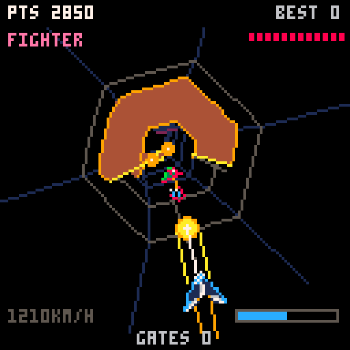
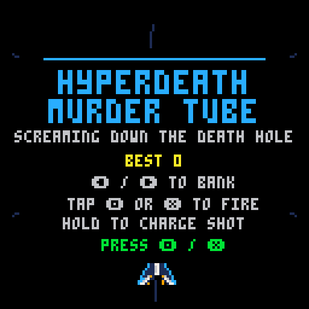
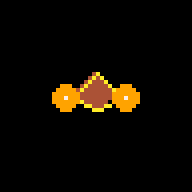

# MURDER TUBE 8172AD
### SCREAMING DOWN THE DEATH HOLE
A vibe-coded game for **PICO-8**

**ONE SHIP. ONE GUN. A COMPLETELY UNREASONABLE AMOUNT OF TUNNEL.**

Strap yourself into a delta-dart death rocket and hurl it down an industrial throat that absolutely does not want you inside it. Bank around the walls. Squeeze through rotating shutters. Vaporise anything rude enough to share your airspace.

This is **Murder Tube 8172AD**: an endless tunnel runner and arcade shooter for **PICO-8**.

Tap out laser fire. Hold your nerve for a charged blast that punches through multiple targets. Clear the bombs or dodge them. Kill quickly, because the enemy does not politely leave when the next one arrives.

**There is no finish line. There is your high score, and the inevitable wreckage of your ship.**

## Enter the tube

Download [murder-tube-8172ad.p8](murder-tube-8172ad.p8) using GitHub's **Download raw file** button. The cartridge contains the whole game; no source files or build step are needed to play.

## Flight instructions

| Input | Action |
| --- | --- |
| **Left / Right** | Bank around the inside of the tube |
| **Tap Z or X** | Fire a normal shot |
| **Hold Z or X, then release** | Charge for one second and unleash a piercing blast |

On a controller, use the D-pad and either PICO-8 action button (**O / X**). Both fire buttons do the same thing. The charge meter and rising sound tell you when the big shot is ready.

Stay inside the gate openings and steer around the ribs. Moving shutters have yellow faces and red edges. Yellow warning marks show where an enemy burst is aimed: move away before it arrives. Bombs can be shot or dodged. Everything solid is very solid indeed.

Your best score saves between sessions. The run summary reports your score, gates cleared, kills and maximum speed. Beat your record and enjoy a brief, entirely justified flash of superiority.

| In the cockpit | At the starting line |
| :---: | :---: |
|  |  |

## Meet the welcoming committee

These enlarged portraits use the actual in-game ship renderer.

| Ship | Identification and recommended attitude |
| :---: | --- |
|  | **LONE FIGHTER** — Green, evasive and thoroughly opposed to your continued existence. Wanders around the opening and fires warned bursts. Give it a charged greeting or a sustained argument. |
|  | **BOMBER** — Orange trouble with a cargo hold full of bad decisions. Lays bombs through the openings you wanted to use. Shoot the bombs, shoot the bomber, or develop an urgent interest in the other side of the tunnel. |
|  | **LIGHT FIGHTER FORMATION** — Three pink pests arriving in sequence, then spreading out to make the tube feel smaller with bombs and burst fire. Clear the whole group for a bonus; line them up for a particularly satisfying charged shot. |
|  | **HEAVY GUNSHIP** — Purple armour, two big weapon pods, absolutely no social skills. Ordinary shots bounce off. Charge your gun and break both pods. It brings bursts and bombs, and losing an engine does not improve its mood. |

## Under the bonnet

The playable cartridge is ready to go. For editing, rebuilding and running the native checks, see [Development](docs/DEVELOPMENT.md).

Cover illustration generated with OpenAI image generation; game screenshots and enemy portraits captured from PICO-8. Cover art is promotional illustration, not a gameplay screenshot.
